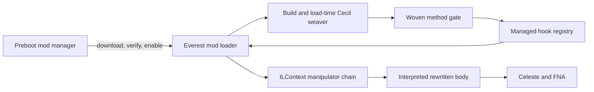

# Everest compatibility on iOS

## Runtime layout

The app keeps Everest's existing mod-facing APIs and substitutes a managed
backend underneath them. iOS builds the host and game ahead of time, then uses
the Mono interpreter for downloaded managed mod assemblies and rewritten
method bodies. Hooking never writes executable pages or emits native code.
MonoMod's Cecil dynamic-method backend is selected at startup. The bundled
`Mono.Cecil*.dll` and `MonoMod.Utils.dll` files remain intact because they
generate interpreted managed bodies at runtime; weaving those generator
libraries breaks that work.

The build runs Everest's patcher against Celeste and FNA, generates and relinks
`MMHOOK_Celeste`, then weaves the patched assemblies and Everest runtime before
packaging. At launch, Everest weaves each managed mod image before loading it
and retains that image for later IL manipulation. Dependency and archive
loading stay in Everest; the iOS manager downloads GameBanana packages, checks
Everest's update hashes, installs required dependencies, and writes the
enabled-package list Everest consumes.

Everest's Lua bridge is included as `NLua` / `KeraLua`. The KeraLua 1.4.7
package also carries an iPhoneOS `liblua54.framework` with an arm64 slice, so
Lua-backed Everest modules do not depend on a desktop Lua binary.

## Dependency resolution

The manager resolves requirements by mod name, with case-insensitive matching
throughout. It merges Everest's current dependency graph with each installed or
pending package's own `everest.yaml`, keeps the highest minimum version when
multiple mods require the same package, builds a de-duplicated dependency-first
closure, and reports cycles before downloading. New campaigns and helpers use
the same data-driven path without a mod-specific branch in the app.

Required packages are downloaded from Everest's update catalog and mirrors,
verified against its xxHash entries, inspected, and enabled. Optional packages
stay optional; they enter load order only when already installed and enabled.
The last valid graph is saved in the user's mod data folder and reused offline.
If neither the live graph nor a valid saved graph is available, the manager
stops before game launch instead of silently ignoring graph-only requirements.

## Hook behavior

### `On.*`, `Hook`, and `Detour`

The weaver copies each ordinary managed body to a private original method and
turns the public method into a gate. The gate takes a direct path to the
original when it has no active hook. With hooks installed, it calls the managed
registry, which applies Everest's `DetourConfig` ordering and sends a typed
`orig` continuation to each hook. The dispatcher supports nested hooks,
registration and removal during play, generic methods, value-type instances,
and `ref` / `out` copyback. Reflected legacy hooks and managed detours use the
same registry.

Everest's public `GenerateTrampoline<T>()` and `GenerateTrampoline(MethodBase)`
entry points both use typed managed wrappers on iOS. A returned trampoline keeps
its exact signature while its continuation is refreshed as downstream hooks and
detours are added, removed, or reordered.

### `IL.*` and `ILHook`

The runtime retains the woven source image for each mod assembly. When a mod
adds or changes an IL hook, the backend opens the original Cecil body, applies
the ordered MonoMod `ILContext.Manipulator` callbacks, and loads a managed
sidecar body for the iOS interpreter. Calls, locals, branches, and exception
regions are copied with the body. Removing the final manipulator restores the
untouched original body.

IL hooks can target closed methods or open generic definitions, including
methods on open generic types. The weaver gives open generic targets a shared
gate, and each interpreted sidecar closes over the concrete type and method
arguments at dispatch time. `On` hooks and detours still require closed generic
targets. Hook gates preserve unusual CLR signatures with exact typed delegates
and generated managed adapters, so by-reference returns,
`ref` / `out` / `in`, pointers, function pointers, typed references, and
byref-like values do not cross an object-boxing boundary. The generated IL is
loaded by Mono's interpreter and does not require runtime native-code emission.

Fresh iOS weaving of the patched game and FNA inputs completed with 11,538 and
3,817 methods woven and no skipped hookable bodies. The audited current mod DLL
set also wove without module failures or unhookable method shapes. A repeat
scan of already-woven game copies can report their generated constructor gates
as skipped; those existing gates remain intact, and a repeat scan is not the
compatibility measure. The smoke suite exercises the typed paths for
by-reference returns, byref-like spans, pointers, and value-type instances.

Mods that require desktop-only APIs, native libraries, `Reflection.Emit`, or
another runtime-specific facility need an iOS implementation of that facility.
That requirement comes from the mod itself and its dependencies, rather than
the asset or map archive format.

## Mod manager and controllers

The native preboot screen provides installed mods, GameBanana search, install,
enable / disable, remove, dependency installation, manual update, automatic
update before launch, and Play. Everest owns final module and content loading.
On-screen game controls are disabled in the CI build. SDL's physical controller
input and Apple's GameController framework stay enabled for both iPhone and
iPad.

## Verification record

Verification record (November 22, 2026):

- The standalone hook runtime harness passed nested `On` hooks, managed
  detours and trampolines, generic dispatch, struct `this`, `ref` copyback,
  constructors, and an `ILContext`-rewritten sidecar body.
- Everest published against the unpatched game and FNA references. Its patcher,
  HookGen, relink, and full assembly-weaving steps completed in CI-shaped
  staging from fresh game and FNA inputs in the earlier build pass.
- The current Everest graph and updater catalog resolved six live roots:
  Glyph, Into the Jungle, Strawberry Jam 2021, Secret Santa Collab 2024,
  Crossover Collab, and Secret Santa Collab 2025. Their required closures had
  4, 12, 51, 80, 74, and 9 downloadable packages respectively. Every current
  catalog version met the declared minimum under Everest's version rule.
  Case-insensitive lookup, duplicate constraint merging, optional dependency
  handling, cycle reporting, offline graph-cache fallback, and empty-graph
  rejection passed. Eight graph-required dependency edges across 104 inspected
  package archives were absent from their root manifests, so the graph is
  required for complete dependency resolution. The `API` dependency alias is
  checked against the bundled Everest core version.
- Current catalogs and manifests were checked for 100 unique packages across
  the two Secret Santa packs and Crossover. The package audit checked catalog
  size, xxHash, and a root Everest manifest for each package.
- The current code-assembly pass parsed 89 declared mod DLLs with no manifest
  failures or assembly identity conflicts. It wove 72,898 methods with zero
  module failures and zero unhookable method shapes. Eight native imports were
  rewritten to iOS linked symbols; the one Windows-only
  `shlwapi!ColorHLSToRGB` import became a managed call.
  That conversion matched the Windows export for every one of the 241³ legal
  H/L/S input tuples.
- In the current package-level rescan, every managed mod assembly completed
  weaving with no skipped hookable methods. The one intentional direct runtime
  method is MonoMod's generic DMD dispatch trampoline, retained for AOT generic
  method compatibility. No package-specific dependency-resolution switch is
  used.

The current code checks verify static dependency resolution and assembly
weaving. A fresh GitHub iOS build, install on the iPhone 15 Pro and iPad Pro
M1, controller play, and in-game checks with the six audited mod roots remain
necessary before claiming device-level compatibility. Static checks cannot
prove that every third-party code mod behaves correctly at runtime.
